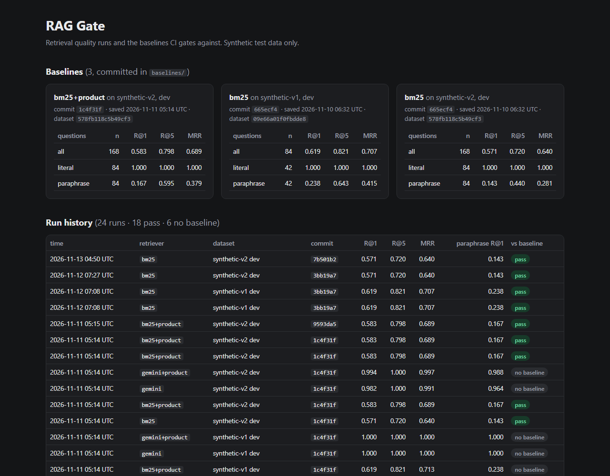
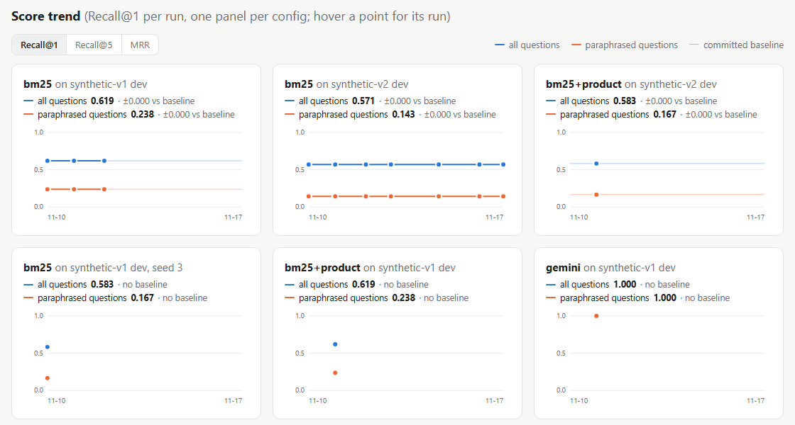
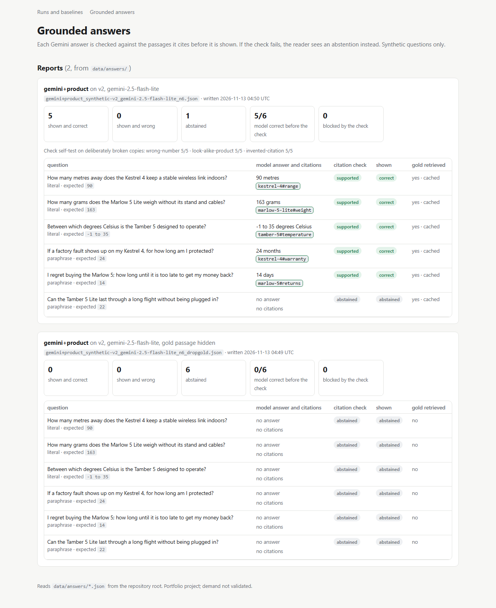

# RAG Gate

[](https://github.com/CodeAvk/rag-gate/actions/workflows/quality-gate.yml)

A TypeScript quality gate for retrieval-augmented generation (RAG). It scores retrieval against a fixed question set, records every run with its config, git commit and dataset fingerprint, checks without any model that each cited passage really supports the answer, and fails CI when a metric drops below the committed baseline.

> Portfolio project. It runs on synthetic data and the free tier of the Gemini API. Demand has not been validated.

## Results so far

All numbers are on synthetic test sets generated in this repo ([docs/CORPUS.md](docs/CORPUS.md)).

| Question | Result | Evidence |
|---|---|---|
| Does the AI beat a non-AI baseline? | Yes, on paraphrased questions. Held-out Recall@5: Gemini embeddings beat BM25 by +19 points (v1) and +52 points (v2); equal on literal questions. | [docs/GATE1_RESULTS.md](docs/GATE1_RESULTS.md) |
| Does a deterministic product-name check help? | Gemini v2 dev paraphrase Recall@1 from 0.964 to 0.988, with no extra API call. | [docs/PRODUCT_CHECK.md](docs/PRODUCT_CHECK.md) |
| Are grounded answers right? | 19 distinct questions answered so far: 18 correct with the right citation, 1 abstention, 0 wrong answers shown. | [docs/ANSWERS.md](docs/ANSWERS.md) |
| Does the citation check catch bad answers? | Gold passage hidden: 6 of 6 abstained. Deliberately broken answers (wrong number, look-alike product, invented citation): every one caught. | [docs/ANSWERS.md](docs/ANSWERS.md) |
| Does the gate stop a regression? | A deliberately raised baseline makes the gate exit 1; an unchanged config passes. | [PLAN.md](PLAN.md) |

The answer sample is small. It grows by about 15 questions a day within the free quota, towards 60.

## How it works

```mermaid
flowchart LR
  C[Synthetic corpus<br/>v1, v2, seeded] --> R{Retriever}
  R -->|BM25| H[Top-k passages]
  R -->|Gemini embeddings<br/>cached vectors| H
  R -->|+ product-name check| H
  H --> E[Metrics<br/>Recall@1, Recall@5, MRR<br/>per question style]
  E --> S[(Run store<br/>config, commit,<br/>dataset hash)]
  S --> G{Gate vs committed<br/>baseline}
  G -->|any drop| F[CI fails, exit 1]
  G -->|no drop| P[CI passes]
  H --> A[Gemini answer<br/>JSON + citations]
  A --> V{Citation check<br/>no model}
  V -->|supported| Y[Answer shown]
  V -->|unsupported| N[Shown as abstention<br/>with reasons]
  S --> D[Next.js dashboard]
  V --> D
```

- **Retrieval** (`src/retrieval/`): BM25 as the non-AI baseline; Gemini embeddings with an on-disk vector cache, a rate limiter and retry after a 429; a hybrid by reciprocal rank fusion (worse than embeddings alone here, so not the default); and a deterministic product-name check that puts the named product's passages first.
- **Evaluation** (`src/eval/`): Recall@1, Recall@5 and MRR, overall and per question style (literal or paraphrased), on a dev split and a held-out split that was run once.
- **Run store and gate** (`src/gate/`): each run is appended to a local history with its config, commit, dataset fingerprint and metrics. A run can be saved as the baseline for its config in `baselines/` (committed). `npm run gate` compares a new run with it and exits 1 if any metric drops by more than the tolerance (0 by default). A run on a changed dataset is refused rather than compared. In CI, each gate step writes a table of metric, baseline and change to the job summary.
- **Grounded answers** (`src/answer/`, `src/gemini/generate.ts`): Gemini answers from the retrieved passages only, as JSON with cited passage ids, or returns no answer. A hard daily request cap, counted on disk, and an answer cache keep it inside the free tier. The sample is prefix-stable, so it grows day by day through the cache, and a run stops cleanly at the cap or on HTTP 429, 500 or 503.
- **Citation check** (`src/answer/verify.ts`): an answer is shown only if it cites something, every cited passage was retrieved, every cited passage is about the product the question names, and every number in the answer appears in the cited text. Otherwise it is shown as an abstention, with the reasons. The CLI also breaks each supported answer three ways and checks that the verifier rejects every copy.
- **Dashboard** (`dashboard/`, Next.js 16, React server components): baselines, a score trend per run config, the run history with pass or regression status, and every answer report with its verdicts. It is read-only and reads the files at request time. A test keeps its status rule in agreement with the CI gate.
- **CI** (`.github/workflows/quality-gate.yml`): on every push and pull request it runs the typecheck, the unit tests and `npm audit`, then the BM25 gate on both dev sets and on BM25 with the product check, then audits, type-checks and builds the dashboard. Actions are pinned to commit SHAs. BM25 needs no API key, so CI uses no secrets.

## Design decisions

- **The AI has to earn its place.** Every AI step is compared with a simpler baseline first: embeddings against BM25. The hybrid was dropped as the default when it lost.
- **No model grades itself.** The answer check is deterministic, so it is cheap, repeatable and testable, and it is tested on broken answers. The trade-off: it fits short factual answers (numbers, named products). An LLM judge would cover open-ended answers that this check cannot.
- **Synthetic data only.** The Gemini free tier may use submitted text to improve Google's products, so the corpus is generated in the repo with exact ground truth. A synthetic set can favour the method its author designs for, so it includes paraphrases and look-alike products, and the held-out split was run once.
- **Free tier, bounded.** Embeddings and answers are cached, requests are capped per Pacific day, and nothing retries automatically in a way that would spend quota.
- **CI gates what it can run without secrets.** Gemini results stay local; CI gates the BM25 configs.

## Run it

Needs Node 22. Gemini runs need `GEMINI_API_KEY` in a git-ignored `.env`.

```
npm install
npm test                                         # unit tests, no network
npm run typecheck
npm run eval                                     # BM25 on the v1 dev split
npm run eval -- --retriever gemini --corpus v2   # embeddings; the first run embeds about 360 items
npm run eval -- --retriever gemini+product --corpus v2
npm run eval -- --corpus v2 --save-baseline      # save this run as the baseline for its config
npm run gate -- --corpus v2                      # what CI runs: exit 1 on any drop
npm run eval -- --corpus v2 --gate --tolerance 0.02
npm run answer -- --limit 60                     # grounded answers; about 15 new a day, cached after
npm run answer -- --drop-gold                    # hide the gold passage: the right outcome is to abstain
npm run probe                                    # measure free-tier limits; up to 60 calls
```

Dashboard (reads `baselines/`, `data/runs/` and `data/answers/` from the repository root):

```
cd dashboard
npm install
npm run dev                                      # http://localhost:3000
```







## Compared with existing tools

promptfoo, Ragas and DeepEval already score retrieval context and answer faithfulness, and promptfoo and DeepEval run in CI, so running evals in CI is not new. Going by their documentation, the differences here are a deterministic citation check instead of an LLM judge, and a gate against a committed, dataset-fingerprinted baseline, which promptfoo's CI docs leave to custom scripting. Details, and what was not checked: [PRODUCT_RESEARCH.md](PRODUCT_RESEARCH.md).

## Limits and work not done

- Synthetic data only; nothing here has been run on a real document set.
- The citation check passes a number that is in a cited passage but answers a different question. Matching the question's topic to the passage is not built.
- Gemini baselines are not committed or gated in CI, because CI has no API key.
- The free-tier daily embedding limit is not measured; the per-minute limit is (100 requests).
- There is no API server, job queue or vector database. The service layer in the original plan was not needed for the gate and was not built.
- Demand has not been validated, and user interviews were waived.

Plan and gates: [PLAN.md](PLAN.md), [VALIDATION_PLAN.md](VALIDATION_PLAN.md).
